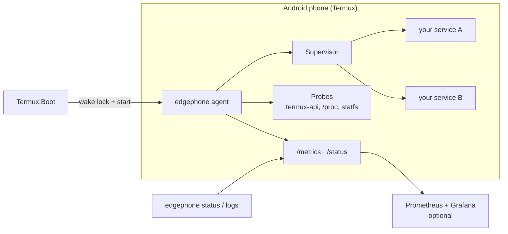

# edgephone

> Turn an old Android phone into a **monitored, self-healing** server.
> One Go binary. No root. Built for people who run real infrastructure.

[](https://github.com/jam-bm/edgephone/actions/workflows/ci.yml)
[](https://goreportcard.com/report/github.com/jam-bm/edgephone)
[](https://github.com/jam-bm/edgephone/releases)
[](LICENSE)

Old phones make great tiny servers. They have an ARM64 CPU, a few GB of RAM, Wi-Fi, and a battery that works like a built-in UPS.
What they lack is the operational layer. Android kills background processes, batteries swell when they're kept at 100%,
and nothing tells you when the phone has quietly stopped working.

`edgephone` adds that layer.

**Available now (v0.1)**

- **Supervisor**: runs your services, health-checks them over HTTP, TCP or a command, and restarts them with exponential backoff. Each service gets its own rotating log.
- **Phone-aware metrics**: battery %, temperature and charging state, Wi-Fi signal, load, CPU, memory and disk at `/metrics` in Prometheus format.
- **`edgephone doctor`**: checks Termux:API, Termux:Boot autostart, the wake lock, battery optimization (with Samsung-specific steps), Android 12+'s phantom process killer, storage and your config. For each problem it tells you exactly how to fix it.
- **`edgephone status` / `logs`**: one screen showing phone health and service state, plus `tail -f` for any service.
- **Autostart**: a Termux:Boot script that takes a wake lock and keeps the agent running across reboots.

**On the roadmap**: smart-plug battery protection (keep the charge between 40% and 80%), Telegram/webhook alerts and atomic deploys with rollback. See the [Roadmap](#roadmap).

---

## Quick start

```bash
# In Termux. Install Termux, Termux:API and Termux:Boot from F-Droid, not the Play Store.
curl -fsSL https://github.com/jam-bm/edgephone/releases/latest/download/install.sh | bash
edgephone doctor          # fix anything it reports
edgephone agent           # or reboot and let Termux:Boot start it
```

The installer checks the SHA-256 of the release archive. It installs the binary to `$PREFIX/bin`, writes an example config to `~/.config/edgephone/config.yaml`, and installs `~/.termux/boot/start-edgephone`.

### What it looks like

`edgephone doctor` on a fresh phone (sample output):

```text
[ ok ] Termux                  running inside Termux on samsung SM-A305F (Android 11)
[ ok ] Binary                  built for android/arm64
[FAIL] Termux:API              termux-battery-status did not answer: termux-battery-status timed out (is the Termux:API app installed?)
                               Install the Termux:API *app* from F-Droid (same source as Termux), then open it once.
                               Mixing F-Droid and Play Store builds does not work: they are signed differently.
[ ok ] Termux:Boot             autostart script: /data/data/com.termux/files/home/.termux/boot/start-edgephone
[ ok ] Wake lock               boot script acquires a wake lock
[todo] Battery optimization    can't be read from inside Termux; check it once by hand
                               Samsung (One UI; menu names vary slightly by version):
                                 Settings > Apps > Termux > Battery > Unrestricted
                                 ...
[ ok ] Phantom process killer  Android SDK 30: not affected (added in Android 12)
[ ok ] Storage                 18.2 GiB free of 50.6 GiB (36%)
[ ok ] Config                  ~/.config/edgephone/config.yaml: node "galaxy-a30", 1 service(s)
```

`edgephone status` (sample output):

```text
galaxy-a30  edgephone v0.1.0  up 3d

battery  78%  31.4°C  charging
wifi     -58 dBm  433 Mbit/s
cpu      load 0.52 0.40 0.31
memory   1.1 GiB available of 2.7 GiB
disk     18.2 GiB free of 50.6 GiB (36%)

SERVICE  STATE    HEALTH  PID    RESTARTS  FOR    LAST EXIT
api      running  ok      12931  2         2h14m  killed after 3 failed health checks
```

### Example config

```yaml
node:
  name: galaxy-a30

services:
  - name: api
    cmd: ["./bin/api", "--port", "8080"]
    workdir: ~/apps/api
    health: { http: "http://127.0.0.1:8080/healthz", interval: 15s, failures: 3 }
    restart: { backoff_max: 2m }

metrics:
  listen: ":9100"        # default 127.0.0.1:9100; use ":9100" to let Prometheus scrape it

probes:
  interval: 30s
```

Run `edgephone init` to get the full annotated config ([`cmd/edgephone/example.yaml`](cmd/edgephone/example.yaml)). Unknown keys are rejected, so a typo like `listne:` fails at startup instead of being silently ignored.

### Metrics

| Metric | Description |
|---|---|
| `edgephone_battery_percent`, `edgephone_battery_temp_celsius` | From `termux-battery-status` |
| `edgephone_battery_charging`, `edgephone_battery_plugged` | Charging vs. plugged in but full |
| `edgephone_wifi_rssi_dbm`, `edgephone_wifi_link_speed_mbps`, `edgephone_wifi_connected` | From `termux-wifi-connectioninfo` |
| `edgephone_load_average{period}`, `edgephone_cpu_usage_ratio` | `/proc/loadavg`; `/proc/stat` when Android allows it |
| `edgephone_memory_total_bytes`, `edgephone_memory_available_bytes` | `/proc/meminfo` |
| `edgephone_disk_total_bytes`, `edgephone_disk_free_bytes` | `statfs` on `$HOME` |
| `edgephone_service_up`, `edgephone_service_healthy`, `edgephone_service_restarts_total`, `edgephone_service_state` | Per supervised service |
| `edgephone_probe_success{probe}` | Each probe reports its own health, so a broken probe never fails silently |
| `edgephone_build_info` | Version, OS, arch, node name |

The agent also serves `/status` (JSON) and `/healthz`.

---

## Architecture



| Package | Responsibility |
|---|---|
| `cmd/edgephone` | CLI entrypoint: `agent`, `status`, `logs`, `doctor`, `init`, `version` |
| `internal/supervisor` | Process lifecycle, process groups, backoff, HTTP/TCP/exec health checks, log rotation |
| `internal/probe` | Termux:API JSON, `/proc/loadavg`, `/proc/stat`, `/proc/meminfo`, `statfs` |
| `internal/metrics` | Prometheus collector built from the latest snapshot on every scrape |
| `internal/agent` | Wires everything together and serves the HTTP endpoints |
| `internal/doctor` | Setup checks with concrete fixes |
| `internal/config` | Strict YAML parsing, defaults, validation that reports every error at once |

More detail is in [docs/architecture.md](docs/architecture.md).

### Key design decisions

- **Go, single static binary.** One file to copy, nothing to install at runtime, and `CGO_ENABLED=0` cross-compiles from any machine.
- **Built with `GOOS=android`, not `linux`.** Android has no `/etc/resolv.conf`, and Go's Android target knows how to resolve DNS there. `doctor` warns if you run a linux build on a phone.
- **No root.** Probes read Termux:API JSON. If Termux:API is missing, that probe reports `edgephone_probe_success{probe="battery"} 0` and the rest keep working.
- **Every Termux:API call has a timeout.** `termux-battery-status` blocks forever when the companion app isn't installed, which is a very common setup mistake.
- **Process groups.** Each service runs in its own group, so stopping or restarting it also stops any workers it spawned. Shutdown sends SIGTERM and follows with SIGKILL after `stop_timeout`.
- **Bounded logs.** Phone storage is small and slow, so each service log rotates at `max_size_mb`.
- **Fail loud.** Every subsystem exposes its own health in `/metrics` and `edgephone status`.

---

## Building from source

```bash
git clone https://github.com/jam-bm/edgephone && cd edgephone
make test                 # go test -race ./...
make android              # dist/edgephone_android_arm64
adb push dist/edgephone_android_arm64 /data/local/tmp/   # or scp it into Termux
```

## Roadmap

- [x] **v0.1**: supervisor, probes, `/metrics`, `status`, `logs`, `doctor`, Termux:Boot autostart
- [ ] **v0.2**: alert engine (firing → resolved, `for:` durations, cooldowns) with Telegram and webhook notifiers
- [ ] **v0.3**: charge controller for Tasmota and Shelly plugs: hysteresis between 40% and 80% plus a temperature cutoff
- [ ] **v0.4**: deploy API, CLI and GitHub Action: token auth over Tailscale, SHA-256 check, atomic symlink swap, health gate and rollback
- [ ] **v0.5**: Grafana dashboard, embedded status page, config reload on SIGHUP
- [ ] **v1.0**: multi-phone fleet view (`edgephone status --all`) with discovery over Tailscale

Ideas and PRs are welcome. See [CONTRIBUTING.md](CONTRIBUTING.md).

## Testing

- Unit tests use fake Termux:API output and a fake `/proc` tree, so they run on any OS.
- Supervisor tests use the test binary itself as the supervised process, covering crash loops, health-check restarts, start periods and graceful stop, with no reliance on `sh` or `sleep`.
- The agent integration test starts the real HTTP server and scrapes `/metrics` and `/status`.
- CI runs `go vet`, `staticcheck` and `go test -race` on Linux and macOS, and cross-builds `android/arm64`.
- Before each release, a smoke test runs on a real device: [docs/release-checklist.md](docs/release-checklist.md).

## Known Android gotchas

See [docs/troubleshooting.md](docs/troubleshooting.md) for the full list.

- **Doze and background kills**: exempt Termux from battery optimization and hold a wake lock. `doctor` walks you through it.
- **Phantom process killer (Android 12+)**: Android may kill Termux child processes with signal 9. `doctor` gives the adb fix.
- **DNS**: use the `android_arm64` build. Plain `linux/arm64` builds can fail DNS lookups.
- **Ports below 1024** need root, so use 8080, 9100 and so on.

## Prior art

- [macintoshi-nakamoto/phonenode](https://github.com/macintoshi-nakamoto/phonenode): a Bash supervisor, keep-alive and tunnel toolkit. Its `doctor` idea inspired ours.
- [madeye/ServerBox](https://github.com/madeye/ServerBox): Linux distros and always-on SSH on Android.
- [mayukh4/linux-android](https://github.com/mayukh4/linux-android): a Termux desktop and Home Assistant setup.

`edgephone` covers the operations side these leave out: metrics and self-healing now, with alerting, battery protection and deploys on the roadmap.

## License

[MIT](LICENSE)
